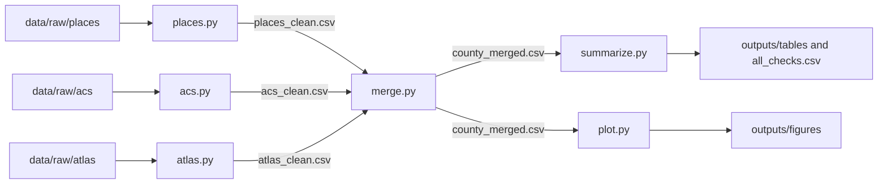
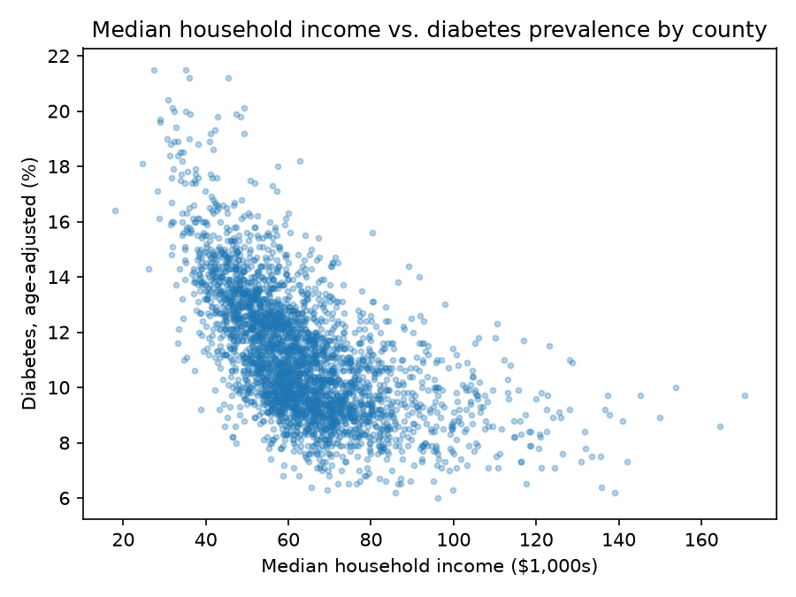

# Interim Status Report (Milestone 3)

## Overview

We study how county median household income, poverty and grocery store availability are associated with estimated diabetes and obesity prevalence, using CDC PLACES (2024 release), Census ACS 2018–2022 and the USDA Food Environment Atlas. This milestone delivers seven scripts that download, check, clean, merge and summarize the sources, plus quality-check tables and three figures. [places_clean.csv](data/processed/places_clean.csv), [acs_clean.csv](data/processed/acs_clean.csv) has 3,144 and [atlas_clean.csv](data/processed/atlas_clean.csv) each have 3,144 rows. The merged table has 3,135 counties, and 18 county codes are unmatched.

## Progress on each task

| Plan task (target) | Status | Deliverables |  |
|---|---|---|---|
| Confirm variables, years, FIPS (Oct 30) | Done | [atlas.py](scripts/atlas.py) |
| Download scripts and repo setup (Nov 5) | Partly done | [utils.py](scripts/utils.py), [run_all.sh](run_all.sh)|
| Pre-integration quality checks (Nov 10) | Done | [pre_places](outputs/quality/pre_places_checks.csv), [pre_acs](outputs/quality/pre_acs_checks.csv), [pre_atlas](outputs/quality/pre_atlas_checks.csv) |
| Clean data, first merged table (Nov 14) | Done | [county_merged.csv](data/processed/county_merged.csv) |
| Join coverage, duplicates, missing values (Nov 18) | Done | [unmatched_counties.csv](outputs/quality/unmatched_counties.csv), [post_merged_checks.csv](outputs/quality/post_merged_checks.csv) |
| Initial graphs and summaries (Nov 22) | Done | [correlations_spearman.csv](outputs/tables/correlations_spearman.csv), [all_checks.csv](outputs/quality/all_checks.csv) |

### CDC PLACES

[places.py](scripts/places.py) requests DIABETES and OBESITY rows from the Socrata API with a fixed sort order and a 50,000-row limit, then pivots them to one row per county. We use age-adjusted prevalence so counties with older populations are comparable. Pre-checks on the 12,580 raw rows found no values outside 0–100, no missing values and no duplicates. Four rows have a non-five-character `locationid`; all four are the national row (`59`), which `clean()` drops. The 52 "states" covered are the 50 states, DC and the US total. The only data year is 2022: the 2024 release describes 2022 BRFSS data.

### Census ACS and workflow

[acs.py](scripts/acs.py) pulls median household income (B19013) with its margin of error for every county from the ACS 5-year API for 2018 to 2022, plus the B17001 counts the poverty rate is built from. The raw response is saved as [acs5_2022_county.json](data/raw/acs/acs5_2022_county.json), and [manifest.json](data/raw/acs/manifest.json) records the URL and query along with a SHA-256 checksum, so a later download can be compared against it. From there the script builds five-character FIPS codes out of the state and county columns and turns the Census annotation codes (large negative numbers) into missing values. It drops the 78 Puerto Rico rows before computing `poverty_rate_pct`, which leaves 3,144 counties in [acs_clean.csv](data/processed/acs_clean.csv).

The checks in [pre_acs_checks.csv](outputs/quality/pre_acs_checks.csv) came back mostly clean. Loving County, Texas is the only county with suppressed values, so it's also the only one missing a median income. There are no duplicate or malformed FIPS codes, and none of the poverty counts are larger than their universe. The number worth watching is the margin of error, which is more than 10% of the income estimate in 857 counties (Bibb County, Alabama is the first one flagged). That's a reminder that ACS estimates for small counties are noisy, so we should be careful about reading too much into any single county.

The Census API now requires a free key. `acs.py` reads it from the `CENSUS_API_KEY` environment variable, so the key never ends up in a file or a commit, and normal runs don't need it because they use the committed raw file. If the API sends back an error page instead of data, the script deletes the bad file and restores the old manifest before stopping with a message on how to get a key.

[run_all.sh](run_all.sh) runs the six scripts in order, and the diagram below shows how files move between them.

Fresh-clone test (Windows 11, Python 3.14.6, pandas 3.1.1): cloning the repo and setting up the virtual environment worked fine, and `bash run_all.sh` finished all six steps with 3,135 merged counties. `git status` wasn't clean afterward, though. The three figures came out slightly different from the committed copies, and `atlas.py` created a `data/raw/atlas/manifest.json` that isn't committed yet. Deleting the ACS JSON and rerunning `acs.py` first failed because the API returned a "Missing Key" page instead of data. After adding key support and setting a key, the fresh download matched the committed file byte for byte with no checksum warning. Getting that far also took a [.gitattributes](.gitattributes) rule, since Git on Windows was rewriting line endings in the raw files and breaking their checksums.

### USDA Food Environment Atlas and figures

Rule: among `GROCPTH##` codes, count counties with a value ≥ 0, then take the most recent year with at least 90% of the highest count. GROCPTH16 has 3,066 counties and GROCPTH20 has 2,234, below the 2,759.4 threshold, so [atlas.py](scripts/atlas.py) uses GROCPTH16 and GROC16 (2016). For both codes, 3,066 of 3,144 counties have values; 76 are -9999 and 2 are -8888. There are no invalid negatives and no short FIPS. All 380 duplicate FIPS+Variable_Code rows are farm rows with blank FIPS. There are 17 Connecticut codes: the 8 old counties and the 9 planning regions.

- [Fig. 1](outputs/figures/fig1_income_diabetes.png): lower-income counties tend to have higher estimated diabetes prevalence.
- [Fig. 2](outputs/figures/fig2_poverty_obesity.png): higher-poverty counties tend to have higher estimated obesity prevalence.
- [Fig. 3](outputs/figures/fig3_grocery_diabetes.png): grocery store availability shows only a weak association with diabetes.

### Integration and post-merge checks

[merge_coverage.csv](outputs/quality/merge_coverage.csv) shows 3,135 counties in all three sources. Of the 18 unmatched codes, 17 are Connecticut (9 planning regions in PLACES and ACS only, and 8 old counties in the Atlas only). The other is Valdez-Cordova (02261, Atlas only). Post-merge checks found no duplicates and no out-of-range values. One income and 78 grocery rates are missing. One name disagrees: "Doña Ana" (PLACES) vs "Doña Ana County" (ACS). Reference years are 2022, 2018–2022 and 2016. Two spot-check counties match the raw files: Hooker, NE (diabetes 9.2, income $43,333) and Fulton, OH (11.5, $71,453).

| Spearman | Income | Poverty rate | Grocery per 1,000 |
|---|---|---|---|
| Diabetes | -0.650 | 0.724 | -0.154 |
| Obesity | -0.566 | 0.506 | -0.067 |

## Updated timeline

| Target | Task | Lead | Status | Completed / expected |
| --- | --- | --- | --- | --- |
| Oct. 25 | Finalize plan, team roles, Git commits, and project-plan release | Everyone | Done | Milestone 2 release |
| Oct. 30 | Confirm variables, data years, links, and FIPS identifiers | Timothy, Grace, Eshan; Zahi reviews | Done | Nov. 19 |
| Nov. 5 | Finish download scripts and basic repository setup | Dataset owners; Eshan coordinates scripts | Partly done | Scripts Nov. 19; live downloads tested by Dec. 4 |
| Nov. 10 | Run and record pre-integration quality checks | Dataset owners; Timothy summarizes | Done | Nov. 19 |
| Nov. 14 | Clean datasets and create the first merged table | Everyone; Zahi leads merging | Done | Nov. 19 |
| Nov. 18 | Check join coverage, duplicates, and missing values | Zahi; everyone validates | Done | Nov. 19 |
| Nov. 22 | Make initial graphs and summaries; prepare status report | Timothy and Grace; all review | Done | Nov. 19 |
| Nov. 29 | Complete analysis, metadata, licensing checks, and full README | Timothy: analysis; Grace: metadata and data dictionary; Eshan: licensing; Zahi: README | Planned | Nov. 29 |
| Dec. 4 | Fresh-clone test, verify data access, finalize final-project release | Eshan: fresh-clone test and data access; Zahi: final release; everyone reviews | Planned | Dec. 4 |

## Changes to the project plan

All four gaps from section 8 are resolved:

- We use age-adjusted prevalence for both conditions.
- Connecticut is excluded for now because ACS 2022 uses planning regions.
- The grocery variable is GROCPTH16 (2016).
- The PLACES dataset's metadata confirms it is Public Domain.

Seven scripts replace the separate download, clean and check scripts: one per source (each with `download()`, `check()` and `clean()`), plus `merge.py`, `summarize.py` and `plot.py`. The raw data are committed to git, so Box isn't needed. The Atlas code -8888 (county did not exist that year) was added to the missing-value rules. Milestone 2 received no content feedback, so no changes came from it.

## Challenges and how we handled them

- **National row in PLACES.** The accuracy check flagged four rows with `locationid` 59, the United States total. Padded to 00059, it looked like a county and appeared in the unmatched report, overstating coverage loss by one. `clean()` now keeps only 5-digit codes; the pre-check still records the rows.
- **Blank Atlas FIPS under pandas 3.** 475 farm rows have no FIPS. `clean_fips()` keeps these as NaN, which crashed the Connecticut check. We fixed it in `atlas.py` with `na=False`, leaving `utils.py` unchanged. These rows also cause the 380 duplicates.
- **The first Atlas script didn't match the output contract.** Its columns were grocery_stores_per_1000 and grocery_store_count, with no year or variable column, so merge.py crashed with KeyError: 'grocery_year'. atlas.py was replaced with a version that follows the spec, and the merge was rerun.
- **Encoding error in a CDC county name.** CDC's published PLACES data stores Doña Ana County, NM as "Doña Ana", which the post-merge name check caught. The join uses FIPS, so values are unaffected. Plan: repair the name for display.

## Individual contributions

#### Timothy

I wrote [places.py](scripts/places.py), which downloads DIABETES and OBESITY data, records six pre-checks, drops the national row, and pivots age-adjusted rates to one row per county. I also wrote [summarize.py](scripts/summarize.py), which produces summary statistics, Spearman correlations, and a combined table of 38 quality checks.

#### Grace

explored the Atlas zip, counted real values for each GROCPTH year and applied the 90% rule. She wrote [atlas.py](scripts/atlas.py), which reads the county file straight from the zip, runs nine pre-checks and converts -9999 and -8888 to NaN. She also wrote [plot.py](scripts/plot.py) and reviewed each figure.

#### Eshan
I added [acs.py](scripts/acs.py) and the ACS raw data, then ran the pre-integration checks it writes. I also ran the fresh-clone test on Windows, which turned up two problems I fixed myself. Git was changing line endings in the raw data, so I added a [.gitattributes](.gitattributes) rule to keep those files byte for byte, and the Census API had started requiring a key, so `acs.py` now reads one from `CENSUS_API_KEY`. The figure and Atlas manifest issues from the same test are listed above for the group. I also wrote this ACS and workflow section and its diagram.

#### Zahi Rahman

Zahi ran [merge.py](scripts/merge.py), reviewed coverage, the unmatched counties and the post-merge checks, and spot-checked two counties against the raw files.
