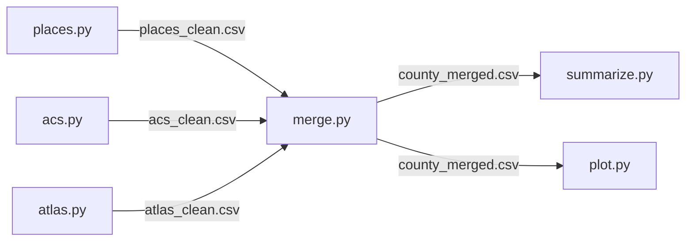

# Interim Status Report (Milestone 3)

## Overview

We study how county median household income, poverty and grocery store availability are associated with estimated diabetes and obesity prevalence, using CDC PLACES (2024 release), Census ACS 2018–2022 and the USDA Food Environment Atlas. This milestone delivers seven scripts that download, check, clean, merge and summarize the sources, plus quality-check tables and three figures. [places_clean.csv](data/processed/places_clean.csv), [acs_clean.csv](data/processed/acs_clean.csv) has 3,144 and [atlas_clean.csv](data/processed/atlas_clean.csv) each have 3,144 rows. The merged table has 3,135 counties, and 18 county codes are unmatched.

## Progress on each task

| Plan task (target) | Status | Artifacts | Lead |
|---|---|---|---|
| Confirm variables, years, FIPS (Oct 30) | Done | [atlas.py](scripts/atlas.py) | Single agent |
| Download scripts and repo setup (Nov 5) | Partly done | [utils.py](scripts/utils.py), [run_all.sh](run_all.sh) | Single agent |
| Pre-integration quality checks (Nov 10) | Done | [pre_places](outputs/quality/pre_places_checks.csv), [pre_acs](outputs/quality/pre_acs_checks.csv), [pre_atlas](outputs/quality/pre_atlas_checks.csv) | Single agent |
| Clean data, first merged table (Nov 14) | Done | [county_merged.csv](data/processed/county_merged.csv) | Single agent |
| Join coverage, duplicates, missing values (Nov 18) | Done | [unmatched_counties.csv](outputs/quality/unmatched_counties.csv), [post_merged_checks.csv](outputs/quality/post_merged_checks.csv) | Single agent |
| Initial graphs and summaries (Nov 22) | Done | [correlations_spearman.csv](outputs/tables/correlations_spearman.csv), [all_checks.csv](outputs/quality/all_checks.csv) | Single agent |

Downloads are Partly done: the network blocked all three hosts, so the raw files were supplied by hand.

### CDC PLACES

[places.py](scripts/places.py) requests DIABETES and OBESITY rows from the Socrata API with a fixed sort order and a 50,000-row limit, then pivots them to one row per county. We use age-adjusted prevalence so counties with older populations are comparable. Pre-checks on the 12,580 raw rows found no values outside 0–100, no missing values and no duplicates. Four rows have a non-five-character `locationid`; all four are the national row (`59`), which `clean()` drops. The 52 "states" covered are the 50 states, DC and the US total. The only data year is 2022: the 2024 release describes 2022 BRFSS data.

### Census ACS and workflow

[acs.py](scripts/acs.py) pulls median income, its margin of error and the B17001 poverty counts, builds FIPS and computes `poverty_rate_pct`. Annotation codes (≤ -100,000,000) are counted, then all negatives become NaN. Of 3,222 raw rows, only Loving County, Texas has annotation codes (income and its margin of error). No incomes are at or below zero, no poverty count exceeds its universe, and there are no duplicate FIPS. The file has 9 Connecticut planning regions, and its 78 Puerto Rico rows are dropped. Re-downloading needs a free [Census API key](https://api.census.gov/data/key_signup.html) set as the `CENSUS_API_KEY` environment variable; it is never written to a file, and normal runs use the committed raw file.

Fresh-clone test (Ubuntu 24.04.5 LTS, Python 3.13.18): the clone, virtual environment and install passed, and `run_all.sh` passed all six steps with byte-identical outputs. Re-downloading the deleted ACS JSON failed because the network blocked api.census.gov. With the file restored, `acs.py` passed with no checksum warning.

### USDA Food Environment Atlas and figures

Rule: among `GROCPTH##` codes, count counties with a value ≥ 0, then take the most recent year with at least 90% of the highest count. GROCPTH16 has 3,066 counties and GROCPTH20 has 2,234, below the 2,759.4 threshold, so [atlas.py](scripts/atlas.py) uses GROCPTH16 and GROC16 (2016). For both codes, 3,066 of 3,144 counties have values; 76 are -9999 and 2 are -8888. There are no invalid negatives and no short FIPS. All 380 duplicate FIPS+Variable_Code rows are farm rows with blank FIPS. There are 17 Connecticut codes: the 8 old counties and the 9 planning regions.

- [Fig. 1](outputs/figures/fig1_income_diabetes.png): lower-income counties tend to have higher estimated diabetes prevalence.
- [Fig. 2](outputs/figures/fig2_poverty_obesity.png): higher-poverty counties tend to have higher estimated obesity prevalence.
- [Fig. 3](outputs/figures/fig3_grocery_diabetes.png): grocery store availability shows only a weak association with diabetes.

### Integration and post-merge checks

[merge_coverage.csv](outputs/quality/merge_coverage.csv) shows 3,135 counties in all three sources. Of the 18 unmatched codes, 17 are Connecticut (9 planning regions in PLACES and ACS only, and 8 old counties in the Atlas only). The other is Valdez-Cordova (02261, Atlas only). Post-merge checks found no duplicates and no out-of-range values. One income and 78 grocery rates are missing. One name disagrees: "Doña Ana" (PLACES) vs "Doña Ana County" (ACS). Reference years are 2022, 2018–2022 and 2016. Two spot-check counties match the raw files: Hooker, NE (diabetes 9.2, income $43,333) and Fulton, OH (11.5, $71,453).

| Spearman | Income | Poverty rate | Grocery per 1,000 |
|---|---|---|---|
| Diabetes | -0.650 | 0.724 | -0.154 |
| Obesity | -0.566 | 0.506 | -0.067 |

## Updated timeline

| Target | Task | Lead | Status | Completed / expected |
| --- | --- | --- | --- | --- |
| Oct. 25 | Finalize plan, team roles, Git commits, and project-plan release | Everyone | Done | Milestone 2 release |
| Oct. 30 | Confirm variables, data years, links, and FIPS identifiers | Timothy, Grace, Eshan; Zahi reviews | Done | Nov. 19 |
| Nov. 5 | Finish download scripts and basic repository setup | Dataset owners; Eshan coordinates scripts | Partly done | Nov. 19 (scripts); live downloads pending |
| Nov. 10 | Run and record pre-integration quality checks | Dataset owners; Timothy summarizes | Done | Nov. 19 |
| Nov. 14 | Clean datasets and create the first merged table | Everyone; Zahi leads merging | Done | Nov. 19 |
| Nov. 18 | Check join coverage, duplicates, and missing values | Zahi; everyone validates | Done | Nov. 19 |
| Nov. 22 | Make initial graphs and summaries; prepare status report | Timothy and Grace; all review | Done | Nov. 19 |
| Nov. 29 | Complete analysis, metadata, licensing checks, and full README | Everyone | Planned | Nov. 29 |
| Dec. 4 | Fresh-clone test, verify data access, finalize final-project release | Everyone | Planned | Dec. 4 |

## Changes to the project plan

All four gaps from section 8 are resolved:

- We use age-adjusted prevalence for both conditions.
- Connecticut is excluded for now because ACS 2022 uses planning regions.
- The grocery variable is GROCPTH16 (2016).
- The PLACES dataset's metadata confirms it is Public Domain.

Seven scripts replace the separate download, clean and check scripts: one per source (each with `download()`, `check()` and `clean()`), plus `merge.py`, `summarize.py` and `plot.py`. The raw data are committed to git, so Box isn't needed. The Atlas code -8888 (county did not exist that year) was added to the missing-value rules. A single agent did this milestone's work in one session. `acs.py` reads a Census API key from an environment variable because the API now requires one. The work plan assigned the Atlas to Grace and ACS to Eshan, the reverse of section 2. Milestone 2 received no content feedback, so no changes came from it.

## Challenges and how we handled them

- **Data hosts blocked.** The run environment returned HTTP 403 for all three hosts, so the files were supplied manually. The ACS JSON is the exact API response. The PLACES export was filtered and reformatted to match the API query. The Atlas CSVs were repackaged into the expected zip. Plan: rerun `download()` on an open network and compare checksums.
- **National row in PLACES.** The accuracy check flagged four rows with `locationid` 59, the United States total. Padded to 00059, it looked like a county and appeared in the unmatched report, overstating coverage loss by one. `clean()` now keeps only 5-digit codes; the pre-check still records the rows.
- **Blank Atlas FIPS under pandas 3.** 475 farm rows have no FIPS. `clean_fips()` keeps these as NaN, which crashed the Connecticut check. We fixed it in `atlas.py` with `na=False`, leaving `utils.py` unchanged. These rows also cause the 380 duplicates.
- **Encoding error in a CDC county name.** CDC's published PLACES data (confirmed in the live API) stores Doña Ana County, NM as "Doña Ana", which the post-merge name check caught. The join uses FIPS, so values are unaffected. Plan: repair the name for display.

## Individual contributions

### Timothy

The AI agent did Timothy's role in this run. It wrote [places.py](scripts/places.py), which downloads DIABETES and OBESITY, records six pre-checks, drops the national row and pivots age-adjusted rates to one row per county. It also wrote [summarize.py](scripts/summarize.py), which produces summary statistics, Spearman correlations and the stacked table of 38 quality checks.

### Grace

The AI agent did Grace's role in this run. It explored the Atlas zip, counted real values for each GROCPTH year and applied the 90% rule. It wrote [atlas.py](scripts/atlas.py), which reads the county file straight from the zip, runs nine pre-checks and converts -9999 and -8888 to NaN. It also wrote [plot.py](scripts/plot.py) and reviewed each figure.

### Eshan

The AI agent did Eshan's role in this run. It wrote [acs.py](scripts/acs.py), which pulls income and poverty counts, counts annotation codes, converts negatives to NaN, builds five-character FIPS and computes poverty rates. It drew the workflow diagram and ran the fresh-clone test: a clean clone, a new environment, `run_all.sh` and a forced ACS re-download.

### Zahi Rahman

The AI agent did Zahi's role in this run. It set up the scaffold, the `agent-run` branch and the virtual environment. It ran [merge.py](scripts/merge.py), reviewed coverage, the unmatched counties and the post-merge checks, and spot-checked two counties against the raw files. It wrote this report and created the `status-report-agent` tag; nothing was pushed to the team repository.
